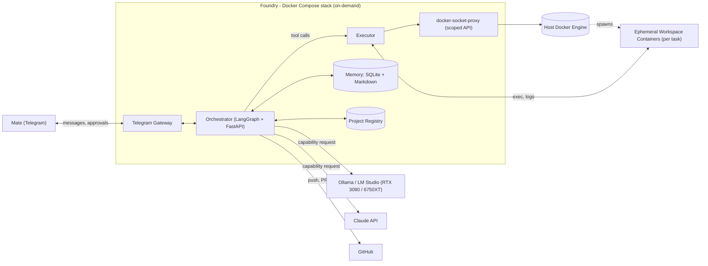
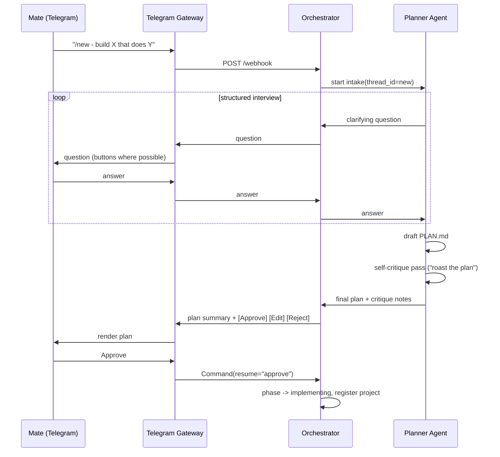
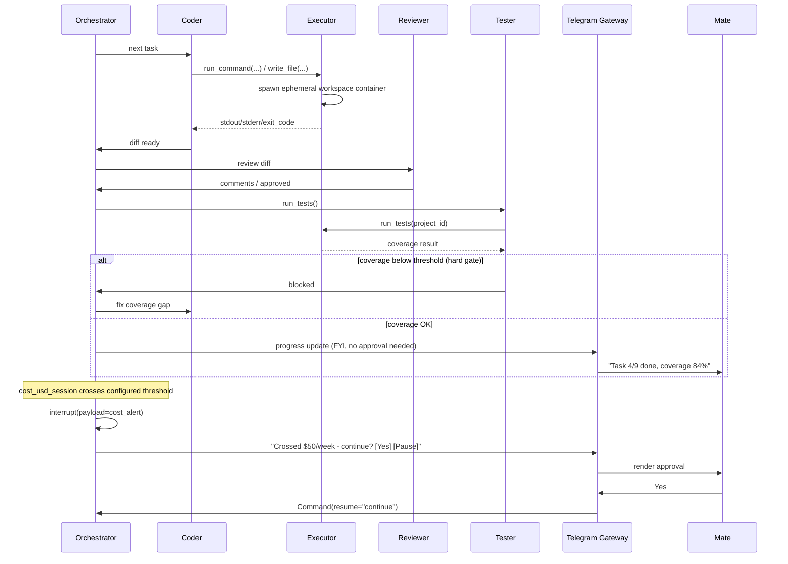
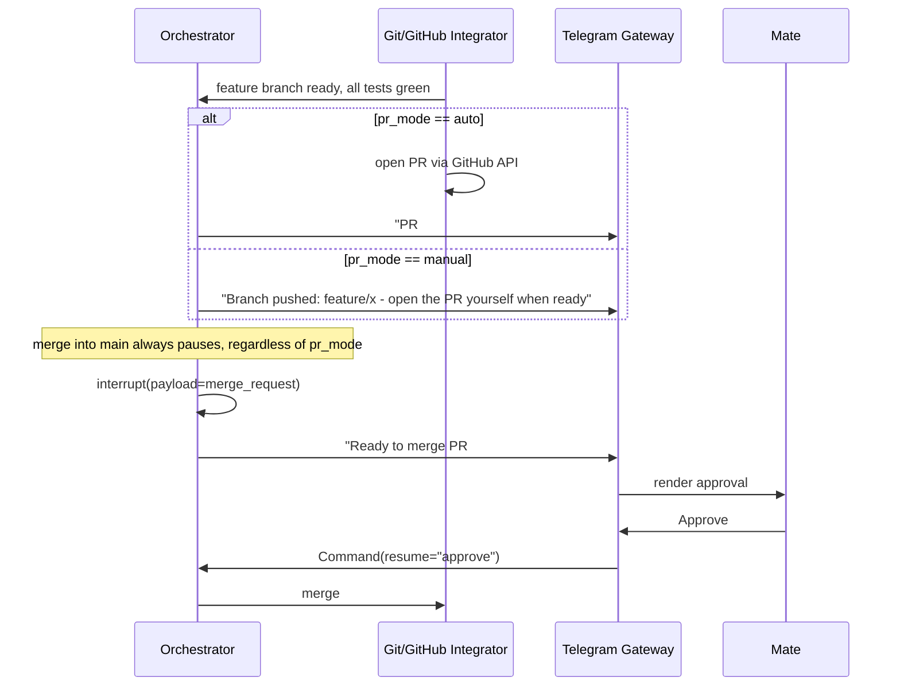
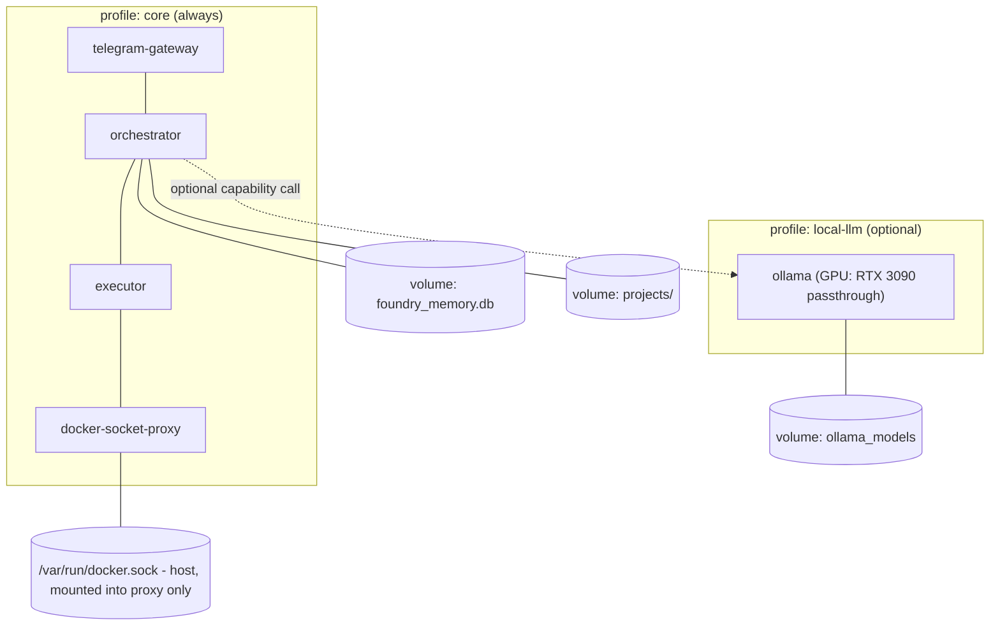

# Foundry — Architecture

A self-hosted, Docker Compose–native multi-agent software development platform. Foundry plans, builds, reviews, and tests software autonomously, supervised through Telegram, running entirely on local hardware (RTX 3090 / 6750XT via Ollama or LM Studio) with optional Claude API for roles that need stronger reasoning, tool-calling reliability, or vision.

> Status: v1 design. This document is the source of truth for architecture decisions. Update it whenever a decision in §10 changes.

---

## Table of Contents

1. [Vision & Scope](#1-vision--scope)
2. [Design Principles](#2-design-principles)
3. [System Context](#3-system-context)
4. [Components](#4-components)
5. [State Schema](#5-state-schema)
6. [Sequence Diagrams](#6-sequence-diagrams)
7. [Docker Compose Topology](#7-docker-compose-topology)
8. [Security Model](#8-security-model)
9. [Repository Layout](#9-repository-layout)
10. [Decision Log](#10-decision-log)
11. [Out of Scope for v1 / Future Work](#11-out-of-scope-for-v1--future-work)
12. [Glossary](#12-glossary)

---

## 1. Vision & Scope

Foundry is both a daily-driver development tool and a portfolio piece. It should be the kind of thing that, on its own, demonstrates production-grade agent system design: clean separation of concerns, a real security boundary around code execution, human-in-the-loop control where it matters, and documentation good enough that a stranger could stand it up from the README.

**What Foundry does:**
- Takes a project idea (greenfield) or an existing repository (brownfield) and turns it into working, tested, reviewed code.
- Interrogates the plan before writing code — a structured intake interview followed by an adversarial self-critique pass ("roast the plan") — rather than guessing at ambiguous requirements.
- Runs autonomously through implement → test → review loops, with regular Telegram progress updates.
- Pauses for an explicit human decision only at the points that are genuinely hard to undo or have real cost: crossing a configured Claude API spend threshold, and merging into `main`.
- Supports multiple projects, each independently configured (coverage threshold, PR mode, cost limits).
- Runs entirely in containers. Nothing is installed on the host beyond Docker itself; agents never get a host shell.

**What Foundry is not (v1):** a SaaS product, a multi-tenant system, or a fully unattended CI replacement. It is a single-operator tool that happens to be built to a standard worth showing off.

---

## 2. Design Principles

Each principle below is grounded in a specific piece of prior art, not invented from scratch:

| Principle | Why | Inspired by |
|---|---|---|
| **Workspace is swappable, agent logic isn't** | Coding agents shouldn't care *where* code runs, only that a workspace can run commands and report output. Local-dev vs. containerized vs. (future) remote should be a config choice. | OpenHands v1's `Workspace` abstraction (Local/Docker/Remote) |
| **Append-only event log is the source of truth** | Every action, observation, and decision is an event. Replaying the log reconstructs full history — this is what makes memory, audit trails, and debugging tractable. | OpenHands v1 event log design |
| **Pause/resume is a first-class primitive, not a bolted-on feature** | Human approval shouldn't require polling or a separate state machine. The graph itself freezes and thaws. | LangGraph `interrupt()` / `Command(resume=...)` + checkpointer |
| **Capability-based model routing, not hardcoded model names** | Agent roles declare what they need (tool-calling, vision, context size); a router resolves that to whichever configured provider satisfies it. Swapping Ollama ↔ Claude API is a config change. | LiteLLM-style provider abstraction |
| **The LLM never touches infrastructure directly** | Agents call narrow, typed tools (`run_command`, `read_file`, `open_pr`). A separate trusted service is the only thing with real Docker/Git/GitHub credentials. | Docker's own findings on coding-agent sandboxing; standard least-privilege design |
| **Skills are portable, not framework-locked** | A "review code" or "review frontend" skill should work whether the executor is a local model, Claude API, or Claude Code. Write it once as a `SKILL.md`. | Anthropic's Agent Skills open standard |
| **Memory should be boring and inspectable** | A human (or a future agent) should be able to open a text file and understand what the system has learned. No opaque embeddings-only memory for v1. | Hermes Agent's session/skill persistence model; deliberately rejected Neo4j for v1 (see ADR-007) |

---

## 3. System Context



Everything inside the dashed boundary is a long-lived or on-demand Docker Compose service. Workspace containers are short-lived and spawned per task by the Executor — they are not part of the static compose file.

---

## 4. Components

### 4.1 Telegram Gateway

A thin, stateless bot service (`aiogram` or `python-telegram-bot`). Its only jobs:

- Authenticate the single allowed Telegram user ID (set during first-run setup).
- Forward free-text messages and commands (`/new`, `/status`, `/projects`, `/approve`, `/reject`) to the Orchestrator's HTTP API.
- Render Orchestrator notifications (progress updates, approval requests, plan drafts) as Telegram messages, using inline keyboards for approve/reject/edit decisions instead of asking the user to type free text where possible.
- Hold **no** business logic, memory, or credentials beyond its own bot token.

This is the only service that talks to the outside world on the human side. If Foundry ever needs to support a second messaging platform, only this service changes.

### 4.2 Orchestrator

A Python service running a LangGraph application, exposing a small FastAPI surface for the Gateway to call (`POST /webhook`, `POST /resume/{thread_id}`, `GET /projects`, `GET /status/{project_id}`).

Two graph levels live in the same process:

- **Global graph**: owns the project registry, routes incoming intents ("new project" vs. "continue project X" vs. "status check") to the correct project thread, aggregates cost across all projects, and is the only thing the Gateway talks to directly.
- **Per-project subgraph**: one LangGraph thread per active project (`thread_id = project_id`), holding that project's `ProjectState` (§5). This is the practical meaning of "sub-orchestrator per active project" — logical isolation via separate threads and state, not a separate OS process per project. If a project later needs harder isolation (e.g. conflicting Python environments at the orchestration layer itself, not just the workspace), promoting it to its own process is a config change, not a rewrite — the LangGraph app is structured so a subgraph can be lifted into its own service.

A Postgres or SQLite checkpointer (start with SQLite given the single-operator scope; see ADR-008) persists graph state so `interrupt()` survives restarts — you can `./foundry down`, come back tomorrow, and resume exactly where a pending approval left off.

### 4.3 Executor & Docker Security Boundary

The Executor is the **only** service that can cause a container to be created, started, or killed. It exposes a narrow internal API to the Orchestrator:

```
run_command(project_id, command, timeout) -> {stdout, stderr, exit_code}
read_file(project_id, path) -> content
write_file(project_id, path, content) -> ok
list_files(project_id, path) -> [entries]
run_tests(project_id, framework) -> {passed, failed, coverage_pct, report}
```

No tool gives an agent raw Docker API access or a host shell. The Orchestrator's agents only ever see these typed functions.

Underneath, the Executor talks to `tecnativa/docker-socket-proxy`, **not** the raw `/var/run/docker.sock`. The proxy is configured to allow only what's needed and deny everything else:

```yaml
# docker-socket-proxy environment (illustrative)
CONTAINERS: 1   # create/start/stop/inspect/remove
EXEC: 1         # exec into running containers
IMAGES: 1       # read image list / pull
POST: 1         # allow the above to actually mutate state
BUILD: 0        # no remote builds via the proxy (build workspace images via a separate, explicit step)
NETWORKS: 0     # no host network reconfiguration
VOLUMES: 0      # no arbitrary volume creation - Executor code decides mounts, never the LLM
SWARM: 0
SYSTEM: 0
```

This is the deliberate alternative to either (a) mounting the real socket directly into a service an LLM's tool calls can reach, or (b) privileged Docker-in-Docker. See ADR-005 for the full reasoning and the upgrade path to Docker's microVM-based Sandboxes if/when that becomes stable enough for a Compose-native workflow.

Each task gets a fresh **workspace container**:
- Built from a per-language base image (`foundry/workspace-python:3.12` for v1).
- Only the target project's directory bind-mounted, read-write, nothing else from the host.
- Runs as a non-root user, `--cap-drop=ALL`, `--security-opt=no-new-privileges`.
- Attached to an isolated bridge network with an explicit egress allowlist (package registries only, by default).
- CPU/memory limits set per project (sane defaults, overridable in `projects.yaml`).
- Torn down after the task completes; nothing persists in the container itself — anything that should persist goes through `write_file` into the bind-mounted project directory.

### 4.4 Model Router

A library (not a network service — no reason to pay a network hop on a single-host system) imported by every agent node. Configuration lives in `config/models.yaml`. Providers are named *instances*, not provider *types* — a single `type: anthropic` provider can be declared multiple times under different names to expose distinct Claude model tiers (e.g. Opus for planning/critique, Sonnet for coding, Haiku for cheap curation), so per-role cost/capability tuning doesn't force every role onto the same pinned model string:

```yaml
roles:
  planner:
    requires: [tool_calling, long_context]
    prefer: [claude_opus, local]
  coder:
    requires: [tool_calling]
    prefer: [local, claude_sonnet]
  reviewer:
    requires: [tool_calling]
    prefer: [local, claude_sonnet]
  frontend_reviewer:
    requires: [tool_calling, vision]
    prefer: [claude_sonnet]      # local models lack reliable vision; documented, not hidden
  memory_curator:
    requires: []
    prefer: [local, claude_haiku]

providers:
  local:
    type: ollama
    base_url: http://ollama:11434
    model: qwen3-coder:30b-a3b
    capabilities: [tool_calling]
  claude_opus:
    type: anthropic
    model: claude-opus-4-8
    capabilities: [tool_calling, long_context, vision]
  claude_sonnet:
    type: anthropic
    model: claude-sonnet-5
    capabilities: [tool_calling, long_context, vision]
  claude_haiku:
    type: anthropic
    model: claude-haiku-4-5
    capabilities: [tool_calling]
```

Each provider declares its own `capabilities:` list explicitly (ADR-016) rather than the router inferring capabilities from `type`. This keeps capability-based routing fully config-driven: if a future Claude tier gains or lacks a capability, that's a `models.yaml` edit, not a code change.

The router resolves `role -> provider` at call time using `prefer` order and falls back to the next provider if the preferred one is unavailable. Availability of `local` is resolved **once at process startup** — from whether the `local-llm` Compose profile is active (e.g. an `OLLAMA_ENABLED` env var set by `start.sh` vs. `start.sh --local-llm`) — not by probing `http://ollama:11434` on every call. This matters because several roles above list `local` first: without a startup-time check, a Claude-only deployment (no `local-llm` profile started) would pay a connection-timeout tax on every single `coder`/`reviewer`/`memory_curator` invocation just because `local` happens to be preferred.

**Claude-only is a first-class deployment mode, not a derived fallback state.** `config/models.claude-only.yaml` ships as a documented preset where every role's `prefer` list contains only `claude_*` providers and no `local` entry at all — the config an operator without a GPU (or who simply wants Claude's reliability everywhere) drops in unchanged, rather than something they have to hand-derive by reordering the local-first default. Switching between presets, or hand-editing `prefer` order, is a config change, not a code change.

### 4.5 Memory System

Two layers, deliberately kept simple (ADR-007):

**Per-project (git-tracked, human-readable):**
```
projects/<project_id>/memory/
  PROJECT_MEMORY.md   # what this project is, current state, key constraints
  DECISIONS.md        # append-only log of decisions made during planning/build
  LEARNINGS.md        # things that went wrong and how they were fixed, this project only
```

**Global (SQLite, cross-project recall):**
```sql
CREATE TABLE memories (
    id INTEGER PRIMARY KEY,
    project_id TEXT,
    type TEXT,        -- 'error_pattern' | 'fix' | 'preference' | 'skill_usage'
    content TEXT,
    tags TEXT,
    created_at TEXT
);
CREATE VIRTUAL TABLE memories_fts USING fts5(content, tags, content=memories);
```

A **Memory Curator** agent runs after each completed phase (not after every message — that would be noisy and expensive). It reads the raw event log for the phase, writes/updates the project's markdown files, and inserts any cross-project-relevant lesson into the global SQLite store. This directly mirrors Hermes Agent's curator pattern, simplified to fit a single-operator system.

Full-text recall uses SQLite FTS5 — proven at this scale (Hermes uses the same mechanism for session search) — no vector database needed for v1.

### 4.6 Project Registry

`projects.yaml` (or a `projects` table in the same SQLite file as memory — start with YAML for human-editability, migrate to SQLite only if the file gets unwieldy):

```yaml
- id: foundry-itself
  name: Foundry
  mode: greenfield
  path: /data/projects/foundry-itself
  git_remote: git@github.com:matete/foundry.git
  stack: python
  coverage_threshold: 80
  pr_mode: configurable    # auto | manual | configurable
  cost_ceiling_usd_weekly: null   # null = use global default
  status: active
```

### 4.7 Specialist Agents (LangGraph nodes)

| Agent | Responsibility | Preferred model capability |
|---|---|---|
| **Planner / Intake** | Structured interview, then a self-adversarial "roast the plan" critique pass before presenting a final plan for approval. | tool-calling, long context |
| **Coder** | Implements tasks inside a workspace container via the Executor. | tool-calling |
| **Reviewer** | Reviews diffs for correctness, style, security smells before tests are even run. | tool-calling |
| **Tester** | Runs the test suite, computes coverage, compares to the project's configured threshold. | tool-calling |
| **Frontend Reviewer** | Visual review of UI changes (screenshots via Playwright). | vision — routes to Claude by default per §4.4 |
| **Docs Writer** | Keeps README/architecture docs in sync with what was actually built. | tool-calling |
| **Git/GitHub Integrator** | Commits to feature branches, opens PRs (if `pr_mode` allows), never touches `main` without approval. | tool-calling |
| **Memory Curator** | Distills session events into project + global memory after each phase. | none required |

### 4.8 Skills

Packaged as portable `SKILL.md` folders (Anthropic's open Agent Skills standard), so they work identically whether the executing model is local, Claude API, or — if ever needed — Claude Code directly:

```
skills/
  develop-python/SKILL.md
  review-code/SKILL.md
  test-and-coverage/SKILL.md
  frontend-review/SKILL.md
  git-ops/SKILL.md
  docs-writer/SKILL.md
  roast-the-plan/SKILL.md
```

---

## 5. State Schema

```python
from typing import TypedDict, Literal, Annotated
from operator import add
from langchain_core.messages import BaseMessage

class ProjectState(TypedDict):
    project_id: str
    mode: Literal["greenfield", "brownfield"]
    phase: Literal[
        "intake", "planning", "roasting", "awaiting_plan_approval",
        "implementing", "reviewing", "testing", "awaiting_cost_approval",
        "awaiting_merge_approval", "pr_pending", "done", "blocked",
    ]
    plan: dict
    messages: Annotated[list[BaseMessage], add]
    task_queue: list[dict]
    current_task: dict | None
    cost_usd_session: float
    cost_usd_weekly: float
    coverage_pct: float | None
    coverage_threshold: int
    pr_mode: Literal["auto", "manual", "configurable"]
    pending_approval: dict | None
```

`pending_approval` is what gets attached to the `interrupt()` payload — the Gateway reads it to render the right Telegram message (plan text + approve/reject buttons, or "cost threshold reached: $42.10 of $50/week — continue?").

---

## 6. Sequence Diagrams

### 6.1 New Project Intake ("Roast the Plan")



### 6.2 Implementation Loop with HITL Gates



### 6.3 Merge-to-Main Gate



---

## 7. Docker Compose Topology



Started on demand via `./foundry up` (not 24/7 — see ADR-010). `docker-socket-proxy` is the *only* container that mounts the real host socket; every other service, including Executor, only ever reaches the proxy's HTTP API over the internal Compose network.

---

## 8. Security Model

1. **No host execution.** Agents never get a shell on the host. The only host-side artifact is the Docker Compose stack itself and the bind-mounted project directories under `projects/`.
2. **Docker socket is never directly exposed to agent-reachable code.** `docker-socket-proxy` sits between the real socket and the Executor, with `BUILD`, `NETWORKS`, `VOLUMES`, `SWARM`, and `SYSTEM` denied (§4.3). Mount decisions are made by Executor code, never by an LLM tool call.
3. **Workspace containers are least-privilege**: non-root, `cap-drop=ALL`, `no-new-privileges`, isolated network with an explicit egress allowlist, CPU/memory limits, and torn down after each task.
4. **Secrets via Docker Compose secrets**, populated once by `./scripts/setup.sh` on first run (Telegram bot token, Claude API key, GitHub token). Never logged, never interpolated directly into prompts — referenced by name and injected only at the tool layer that needs them.
5. **Single-operator authentication.** The Telegram Gateway only responds to one allow-listed Telegram user ID, set during setup.
6. **Hard-to-undo actions are gated.** Per the decision log: merging into `main` always pauses for approval. Everything else (feature-branch commits, file deletes within the project mount, dependency installs inside workspace containers) runs autonomously, with the Claude API weekly cost threshold as the other explicit gate.

---

## 9. Repository Layout

```
foundry/
├── ARCHITECTURE.md
├── TODO.md
├── README.md
├── docker-compose.yml
├── docker-compose.local-llm.yml      # profile overlay
├── .env.example
├── secrets/                          # gitignored - only *.example committed
├── scripts/
│   ├── setup.sh                      # first-run secrets + config wizard
│   ├── start.sh
│   └── stop.sh
├── config/
│   └── models.yaml
├── images/
│   ├── workspace-python/Dockerfile
│   └── ...
├── services/
│   ├── telegram_gateway/
│   ├── orchestrator/
│   │   ├── graph/                    # LangGraph nodes, state, checkpointer
│   │   ├── agents/                   # planner, coder, reviewer, tester, ...
│   │   └── memory/
│   └── executor/
├── skills/
│   ├── develop-python/SKILL.md
│   ├── review-code/SKILL.md
│   ├── test-and-coverage/SKILL.md
│   ├── frontend-review/SKILL.md
│   ├── git-ops/SKILL.md
│   ├── docs-writer/SKILL.md
│   └── roast-the-plan/SKILL.md
├── projects/                         # bind-mounted project workspaces + memory
└── tests/
```

---

## 10. Decision Log

Lightweight ADR-style record of every decision made during planning, so the reasoning isn't lost.

| # | Decision | Rationale |
|---|---|---|
| 001 | Support both local (Ollama/LM Studio) and Claude API, swappable per role | Cost control + capability flexibility; capability-based router (§4.4) keeps the swap config-only |
| 002 | Telegram as the sole messaging interface | Simplicity for a single-operator system; Gateway is isolated so a second platform is a contained addition later |
| 003 | Build to portfolio quality from day one | Explicit goal — clean docs, diagrams, ADRs, tests throughout, not bolted on at the end |
| 004 | Secrets via Docker Compose secrets, wizard on first run | Compose-native, no extra service, good enough for single-host/single-operator |
| 005 | Docker access via `docker-socket-proxy`, never a raw socket mount into agent-reachable services | Mounting `docker.sock` directly grants root-equivalent host access; a scoped proxy is the standard mitigation short of microVM isolation (Docker Sandboxes), which isn't yet Compose-native enough to adopt for v1 |
| 006 | Global orchestrator + per-project LangGraph thread (not per-project OS process) | Matches "sub-orchestrator per project" intent without N processes; promotable to separate processes later if isolation needs grow |
| 007 | Memory = git-tracked markdown (per-project) + SQLite/FTS5 (global), no Neo4j or vector DB in v1 | Explicitly chosen over a Neo4j hybrid: keeps memory human-readable and git-diffable; revisit if cross-project pattern queries become a real bottleneck (see §11) |
| 008 | SQLite checkpointer for LangGraph persistence (not Postgres) | Matches single-operator, on-demand-startup scope; Postgres is a one-line swap if ever needed |
| 009 | Only two hard approval gates: Claude API cost threshold (globally configurable) and merge-to-`main` | User explicitly chose minimal gating for autonomy; merge-to-main added as a non-negotiable safety net regardless of cost state, since it's the one classically hard-to-undo action |
| 010 | Stack starts on-demand (`./foundry up`), not 24/7 | Home GPU box; avoids idle power/thermal/noise cost and unnecessary always-on attack surface |
| 011 | No Prometheus/Grafana in v1 | Explicitly deferred - structured logs only for now; clean upgrade path exists if added later (see §11) |
| 012 | Python-first workspace images | Matches primary stack; polyglot images added incrementally as needed (Phase pattern in TODO.md) |
| 013 | Coverage threshold and PR mode configurable per project | Not every project needs the same bar; registry (§4.6) carries per-project overrides |
| 014 | Skills authored as portable `SKILL.md` | Open standard, works across local/Claude API/Claude Code without rewriting |
| 015 | Claude-only is a first-class model-router deployment mode; Claude providers are declared per-tier (`claude_opus`/`claude_sonnet`/`claude_haiku`), and `local` availability is a startup-time check, not a per-call probe | An all-Claude deployment (no GPU, or an operator who just wants Claude everywhere) must not pay Ollama connection-timeout latency on every call to a `local`-preferring role, and should be able to route different roles to different Claude cost/capability tiers instead of one pinned model for every role |
| 016 | Provider capabilities (`tool_calling`, `long_context`, `vision`, ...) are declared explicitly per provider entry in `models.yaml` via a `capabilities:` field, not inferred from `type` | Keeps capability-based routing (§4.4) fully config-driven — a provider's real capability profile can change (e.g. a future Claude tier gaining or lacking vision) without a code change; inferring capabilities from `type` would hardcode an assumption that every provider of a given type shares identical capabilities |

---

## 11. Out of Scope for v1 / Future Work

- **Neo4j memory upgrade.** If cross-project pattern recall ("this error/fix pattern showed up in 3 projects") becomes valuable enough to justify the operational cost, add it as an additional structured layer underneath the markdown files — not a replacement for them. Neo4j's native vector index could also absorb semantic search duties without a 4th datastore.
- **Observability stack (Prometheus/Grafana).** Deliberately deferred. When added, instrument the Orchestrator and Executor with a `/metrics` endpoint and ship a dashboard — natural fit given the operator's professional background, but not a v1 blocker.
- **A2A protocol exposure.** If Foundry's agents should ever be callable from another A2A-compliant system, or call out to one, expose an Agent Card and adopt the task lifecycle — not needed while Foundry is a closed, single-operator system.
- **MCP servers.** Filesystem and GitHub MCP servers are candidates for Phase 2+ once the custom Executor/Git-Integrator tools prove insufficient for some workflow; not required for v1 since the narrow typed tools (§4.3) already cover the core loop.
- **AMD 6750XT / ROCm parity.** Ollama's ROCm support is less mature than CUDA. Treat the 6750XT as a secondary inference target for smaller helper roles (e.g. memory curation) rather than assuming feature parity with the 3090 from day one.
- **Docker Sandboxes / microVM isolation.** If Docker's Sandboxes product matures into something Compose-native, it's a strictly stronger replacement for the socket-proxy pattern in §4.3 — worth revisiting, not worth blocking v1 on.

---

## 12. Glossary

- **Workspace** — an ephemeral, isolated container where a single task actually executes (read/write only within the mounted project directory).
- **Executor** — the trusted service that is the sole owner of the Docker control surface and exposes narrow typed tools to agents.
- **Capability** — a declared requirement of an agent role (e.g. `vision`, `tool_calling`, `long_context`) used by the Model Router to pick a provider.
- **Phase** — a stage in a project's lifecycle (`intake`, `implementing`, `testing`, etc.) tracked in `ProjectState.phase`.
- **HITL gate** — a point where the graph calls `interrupt()` and waits for a Telegram-driven `Command(resume=...)`.
