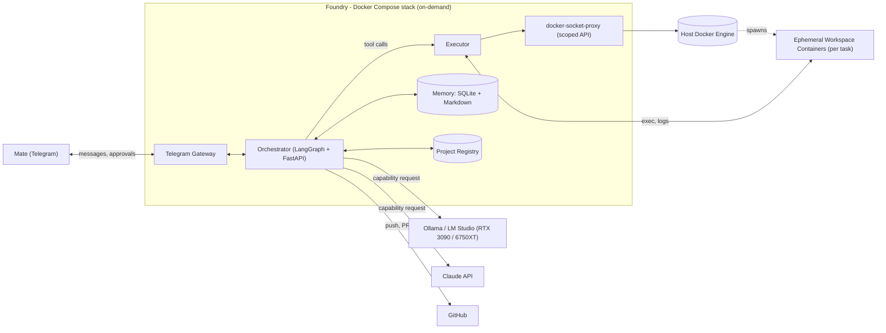

# Foundry

A self-hosted multi-agent software development platform. Agents plan, build,
review, and test code autonomously inside isolated Docker containers,
supervised through Telegram, with LangGraph orchestration and configurable
local (Ollama) or remote (Claude API) inference.

Give it a project idea — or point it at an existing repo — and it runs an
intake interview, drafts and self-critiques a plan, then works through
implement → test → review loops on its own. It only stops to ask a human
for two things: crossing a configured Claude API spend threshold, and
merging into `main`. Everything else, it does autonomously inside
short-lived, least-privilege containers that never get a host shell.

**Status:** Phases 0–20 of the build plan (see [`TODO.md`](TODO.md)) are
complete — secrets/compose bootstrap, model routing, the Docker security
boundary, the full agent lineup (Planner, Coder, Reviewer, Tester, Frontend
Reviewer, Memory Curator, plus deterministic git/GitHub integration),
memory, multi-project concurrency, and packaged skills. Security hardening
(Phase 21) is next.

## Why it's built this way

- **The LLM never touches infrastructure directly.** Agents call narrow,
  typed tools (`run_command`, `read_file`, `open_pr`); only the Executor
  service holds real Docker credentials, and only via a scoped
  `docker-socket-proxy` — never a raw socket mount.
- **Pause/resume is a first-class primitive**, not a bolted-on feature.
  LangGraph's `interrupt()`/`Command(resume=...)` plus a SQLite
  checkpointer mean a pending approval survives `./foundry down` and a
  restart the next day.
- **Capability-based model routing**, not hardcoded model names. Swapping
  a role between a local Ollama model and the Claude API is a
  `config/models.yaml` edit, not a code change.
- **Memory is boring and inspectable.** Per-project markdown files plus a
  global SQLite/FTS5 store — a human can open a text file and understand
  what the system has learned. No opaque embeddings-only memory for v1.

See [`ARCHITECTURE.md`](ARCHITECTURE.md) for the full design, decision log,
and threat model, and [`TODO.md`](TODO.md) for the phased build plan this
repo was built against.

## Architecture



Everything inside the dashed boundary is a long-lived or on-demand Docker
Compose service. Workspace containers are short-lived and spawned per task
by the Executor — they are not part of the static compose file. Full
component breakdown in [`ARCHITECTURE.md` §4](ARCHITECTURE.md#4-components).

## Quickstart

Requires Docker and Docker Compose. No Python/Node install needed on the
host — everything runs in containers.

```bash
git clone <this-repo-url>
cd foundry
./scripts/start.sh          # or: ./foundry up
```

First run prompts you for four secrets (stored under `secrets/`, mode
`600`, gitignored): a Telegram bot token from
[@BotFather](https://t.me/BotFather), your numeric Telegram user ID, a
Claude API key, and a GitHub personal access token. It then writes a
`.env` with `PROJECTS_HOST_PATH` and brings the stack up. Re-running
`./scripts/start.sh` later is a no-op on secrets — it just restarts the
stack.

Once the stack is up, open a chat with your bot on Telegram and send:

```
/new Build me a small CLI that converts CSV to JSON
```

That's enough to kick off an intake interview and start a new project
thread — no separate registration step required. If you want explicit
control over a project's stack, coverage threshold, or PR mode instead of
the defaults, register it first with the CLI and then just talk to the bot
about it:

```bash
./foundry new-project my-project --name "My Project" --stack python \
  --coverage-threshold 85 --pr-mode manual
```

Useful commands while it's running:

```bash
./foundry status  # docker compose ps
./foundry logs    # tail all service logs (accepts service names)
./foundry down    # stop the stack
```

To use a local model (Ollama on an RTX 3090) for roles that don't need
Claude-tier reasoning: `./scripts/start.sh --local-llm`.

> **Screenshot / demo clip:** coming soon — will show a real Telegram run
> once one's been captured against a live deployment.

## Development

See [`CONTRIBUTING.md`](CONTRIBUTING.md) for dev setup, test/lint commands,
and branch/commit conventions, and [`SECURITY.md`](SECURITY.md) for the
security model and how to report a vulnerability.

## License

[MIT](LICENSE)

## Author

Mate Balogh — [GitHub](https://github.com/snipa14) ·
[LinkedIn](https://www.linkedin.com/in/mate-balogh-967b3214b/)
