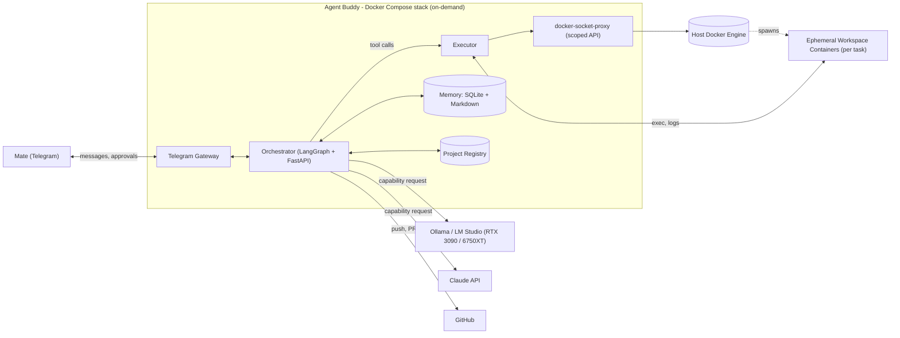

<div align="center">

# 🔥 Agent Buddy

### Give it an idea. Get back reviewed, tested, merge-ready code.


*A self-hosted multi-agent dev team that plans, builds, reviews, tests,*
*and PRs your code — supervised from your phone.*

</div>

---

Agent Buddy is a self-hosted multi-agent development platform. Point it at a
project idea — or an existing repo — and a team of agents interviews you
about it, plans it, builds it, reviews it, tests it, and opens a PR,
looping on its own until the work is actually done. You supervise from
Telegram, from wherever you are. It runs entirely in Docker containers on
hardware you own, with inference routed to a local GPU, a remote
OpenAI-compatible server, or the Claude API — your call, per agent role.

> **Status:** All 24 core phases of the build plan (see
> [`TODO.md`](TODO.md)) are complete — secrets/compose bootstrap, model
> routing, the Docker security boundary, the full agent lineup below,
> memory, multi-project concurrency, packaged skills, and a security
> hardening pass. Remaining work is Phase 25's opt-in stretch goals
> (MCP servers, cross-project pattern memory, deployment tooling). CI
> isn't wired up yet — see [`TODO.md`](TODO.md) for what's manually vs.
> automatically verified.

## 🧠 Why Agent Buddy

- **The LLM never touches infrastructure directly.** Agents call narrow,
  typed tools (`run_command`, `read_file`, `open_pr`); only the Executor
  service holds real Docker credentials, and only via a scoped
  `docker-socket-proxy` — never a raw socket mount.
- **Pause/resume is a first-class primitive**, not a bolted-on feature.
  LangGraph's `interrupt()`/`Command(resume=...)` plus a SQLite
  checkpointer mean a pending approval survives `./foundry down` and a
  restart the next day.
- **Capability-based model routing**, not hardcoded model names. Swapping
  a role between a local or remote self-hosted model and the Claude API is
  a `config/models.yaml` edit, not a code change.
- **Memory is boring and inspectable.** Per-project markdown files plus a
  global SQLite/FTS5 store — a human can open a text file and understand
  what the system has learned. No opaque embeddings-only memory for v1.

Most agent CLIs give you one model, in one session, that you drive turn by
turn — you're the reviewer, the security boundary, and the "did the tests
actually pass" check. Agent Buddy is built to need you for exactly two
decisions instead:

| | A single agent session you drive | Agent Buddy |
|---|---|---|
| **Security boundary** | Whatever shell access you granted it | Scoped Docker proxy, non-root, `cap_drop: ALL`, per-task isolated containers |
| **Review** | Same model reviews its own work, if at all | Separate Reviewer, Tester, and Frontend Reviewer agents each take a real pass |
| **Autonomy** | Needs you present for every turn | Runs implement → test → review loops unattended |
| **Human gates** | Ad hoc, whenever you happen to look | Exactly two: a spend threshold, and merge-to-`main` |
| **Cost** | Every token through one paid API | Route cheap/repetitive roles to a local GPU, reserve Claude for roles that need it |
| **Supervision** | Tied to a terminal or IDE window | Telegram — approve a plan or a merge from your phone |
| **Memory** | Resets when the session ends | Persistent per-project notes + cross-project recall |

See [`ARCHITECTURE.md`](ARCHITECTURE.md) for the full design, decision log,
and threat model, and [`TODO.md`](TODO.md) for the phased build plan this
repo was built against.

## 🤖 The agent lineup

Each role is a distinct pass over the work, not one model wearing
different hats in the same context:

| Agent | What it does |
|---|---|
| **Planner** | Runs a structured intake interview, drafts a plan, then adversarially self-critiques it ("roast the plan") before a human ever sees it |
| **Coder** | Implements one task at a time inside a workspace container, using scoped `read_file`/`write_file`/`run_command` tools |
| **Reviewer** | Reviews the diff for bugs, security issues, and missing checks; approve or changes-requested routes straight back to Coder |
| **Tester** | Runs the real test suite and enforces the project's coverage gate (hard / soft / configurable) inside the workspace container |
| **Frontend Reviewer** | Screenshots UI changes at desktop and mobile breakpoints and sends them to a vision-capable model for a real visual review |
| **Memory Curator** | Extracts lessons from what just happened into per-project markdown and a global store other projects can recall from |
| **Git/GitHub Integrator** | Commits to feature branches autonomously, opens PRs per `pr_mode`, and always gates merge-to-`main` behind explicit human approval |

## 🏗️ Architecture



Everything inside the dashed boundary is a long-lived or on-demand Docker
Compose service. Workspace containers are short-lived and spawned per task
by the Executor — they are not part of the static compose file. Full
component breakdown in [`ARCHITECTURE.md` §4](ARCHITECTURE.md#4-components).

## 🚀 Try it in 5 minutes

Requires Docker and Docker Compose. No Python/Node install needed on the
host — everything runs in containers.

```bash
git clone <this-repo-url>
cd foundry
./scripts/start.sh          # or: ./foundry up
```

First run prompts you for four secrets (stored under `secrets/`, mode
`600`, gitignored): a Telegram bot token from
[@BotFather](https://t.me/BotFather), your numeric Telegram user ID, a
Claude API key, and a GitHub personal access token. It then writes a
`.env` with `PROJECTS_HOST_PATH` and brings the stack up. Re-running
`./scripts/start.sh` later is a no-op on secrets — it just restarts the
stack.

Once the stack is up, open a chat with your bot on Telegram and send:

```
/new Build me a small CLI that converts CSV to JSON
```

That's enough to kick off an intake interview and start a new project
thread — no separate registration step required. Here's roughly what that
conversation looks like end to end (illustrative — not a captured
transcript):

> **You:** `/new Build me a small CLI that converts CSV to JSON`
>
> **Agent Buddy:** Got it — a couple of questions first. Should it read from
> a file path, stdin, or both?
>
> **You:** Both — file path argument, or stdin if none is given.
>
> **Agent Buddy:** *(two more questions, then)* Here's the plan: [...]. While
> critiquing my own draft I found a gap — no handling for malformed CSV
> rows — and added a task for it. Approve, edit, or reject?
>
> **You:** Approve
>
> **Agent Buddy:** 🔨 Implementing... ✅ tests passing, 94% coverage. 👀
> Reviewed — no issues found. Opened PR #1.
> Ready to merge into `main` — approve?

Everything between "Approve" and the merge question happens without you —
that's the loop the rest of this README is about.

If you want explicit control over a project's stack, coverage threshold,
or PR mode instead of the defaults, register it first with the CLI and
then just talk to the bot about it:

```bash
./foundry new-project my-project --name "My Project" --stack python \
  --coverage-threshold 85 --pr-mode manual
```

Useful commands while it's running:

```bash
./foundry status  # docker compose ps
./foundry logs    # tail all service logs (accepts service names)
./foundry down    # stop the stack
```

### 🖥️ Running local instead of Claude API

To use a local model for roles that don't need Claude-tier reasoning:

- **GPU on the Agent Buddy host** — runs Ollama as a Compose service:
  `./scripts/start.sh --local-llm`.
- **GPU on a different machine** — e.g. an RTX 3090 PC on the LAN running
  LM Studio's OpenAI-compatible server. Copy the preset over the active
  config, fill in that machine's address, and start normally (no
  `--local-llm`, nothing downloaded on the host):

  ```bash
  cp config/models.remote-llm.yaml config/models.yaml
  # edit config/models.yaml: base_url -> your GPU machine's LAN address
  #                          model    -> the id it reports at /v1/models
  ./scripts/start.sh
  ```

  See [`docs/model-router.md`](docs/model-router.md) for the full provider
  reference and ADR-048 in [`ARCHITECTURE.md`](ARCHITECTURE.md#10-decision-log)
  for the design rationale.

```
$ ./foundry --help
Usage: foundry <command> [args]

Commands:
  up            Start the Agent Buddy stack (accepts --local-llm)
  down          Stop the Agent Buddy stack
  status        Show status of Agent Buddy services
  new-project   Register a new project (greenfield or brownfield)
  logs          Tail logs from Agent Buddy services (accepts service names)

  -h, --help    Show this help message
```

*(Real output from this repo's `./foundry` CLI — not staged.)*

> **Demo GIF:** not yet recorded. [`scripts/demo.tape`](scripts/demo.tape)
> is a [VHS](https://github.com/charmbracelet/vhs) script that captures a
> real `up` → `status` run — no scripted fake conversation. Run
> `vhs scripts/demo.tape` on a configured Agent Buddy host to generate
> `assets/demo.gif`.

## 🧪 Development

See [`CONTRIBUTING.md`](CONTRIBUTING.md) for dev setup, test/lint commands,
and branch/commit conventions, and [`SECURITY.md`](SECURITY.md) for the
security model and how to report a vulnerability.

## 📄 License

[MIT](LICENSE)

## ✍️ Author

Mate Balogh — [GitHub](https://github.com/snipa14) ·
[LinkedIn](https://www.linkedin.com/in/mate-balogh-967b3214b/)

---

<div align="center">

If Agent Buddy's useful to you, a ⭐ on the repo helps others find it.

</div>
